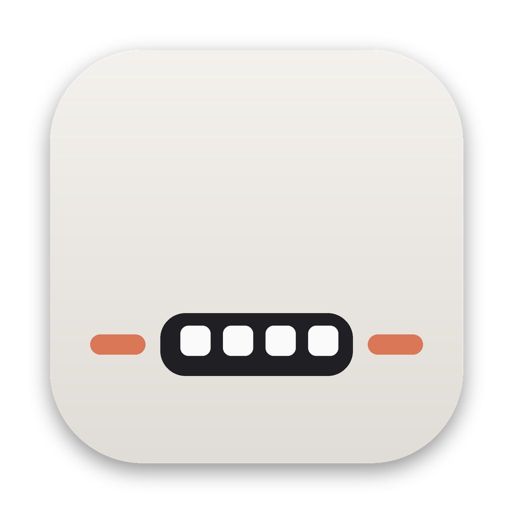
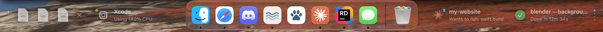
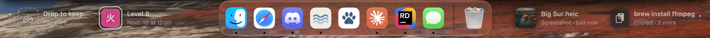

<div align="center">
  
  <h1>DockWings</h1>
  <p>Quiet widgets in the empty space beside the macOS Dock.</p>

  <p>
    
    
    
  </p>
</div>




## What it does

The Dock leaves two empty strips of screen on either side. DockWings fills them with small widgets ("wings"): no background or glass, just text and icons over your wallpaper, dimmed at rest and brighter when the pointer is at the Dock. Text turns dark on bright wallpapers.

- **Music**: now playing from [Tide](https://github.com/bonkedbythonk/tide), Music or Spotify, with controls. Swipe sideways to seek or skip. With Tide the drawer adds search, lyrics and the queue.
- **Claude Code**: which sessions are working, waiting for you or done.
- **WaniKani**: reviews and lessons waiting, with reviews right in the drawer. Needs your own API token.
- **Reminders**: what's overdue or due today; the drawer has the full list and adds new ones.
- **File shelf**: drop files on it to keep them at hand, drag them out again.
- **Weather, batteries** (Mac, AirPods and more), **clipboard history**, the **latest screenshot or download**, **finished terminal commands**, and a warning when something uses too much CPU.
- **Buddy**: an optional Shimeji character that walks along the Dock. Find characters in Settings, Buddy (search itch.io, or import a zip, rar, 7z or folder).

Swipe up or down on a wing for more pages when there isn't room for everything. Only widgets with something to show take space.

## Install

You need macOS 26 or later. Paste this into Terminal:

```bash
curl -fsSL https://raw.githubusercontent.com/bonkedbythonk/dockwings/main/Scripts/install.sh | bash
```

Run the same line again to update.

The first launch walks you through the permissions: Accessibility (to find exactly where the Dock is), Screen Recording (to pick light or dark text from what's behind the wings), Reminders and Location, each optional. It can also add the Claude Code hooks and the terminal hook, and start DockWings at login. Open DockWings again from Spotlight or Finder to get back to Settings.

DockWings isn't signed with a developer certificate, so macOS may ask for Accessibility and Screen Recording again after an update. Turn DockWings off and on in System Settings, Privacy & Security if a widget stops working after one.

<details>
<summary>Installing by hand</summary>

Download `DockWings.zip` from [Releases](https://github.com/bonkedbythonk/dockwings/releases) and move DockWings to Applications. It isn't notarized, so macOS blocks the first launch: open it once, then go to System Settings > Privacy & Security and click **Open Anyway**. Or run `xattr -dr com.apple.quarantine /Applications/DockWings.app`.

</details>

## Disclaimer

Personal project, no support promised. Built and tested on an Apple silicon Mac; the Intel build is untested. Buddy characters are made by their own artists and aren't part of DockWings.

## Building

```bash
./build.sh            # build/DockWings.app
./build.sh --install  # also replaces /Applications/DockWings.app and restarts it
```

`defaults write local.dockwings Demo a` (or `b`, `cycle`) fills every widget with made-up data, which is where the screenshots above come from; `defaults delete local.dockwings Demo` turns it off.

Licensed under [GPLv3](LICENSE).
